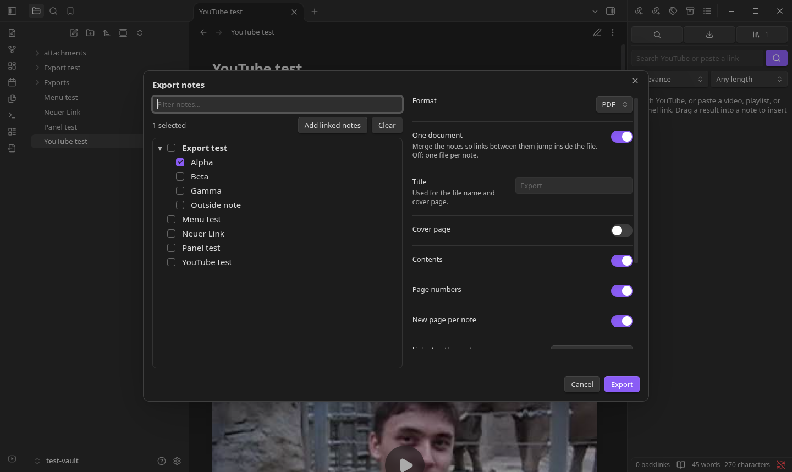
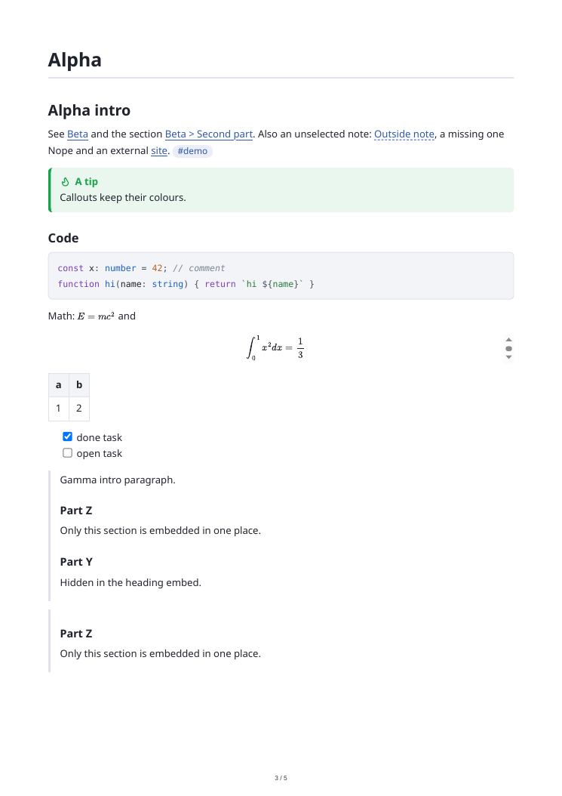

# Export Studio for Obsidian

Export notes to **PDF** or **HTML** with Starnote's clean look, and with **clickable links between the
exported notes**. Desktop only, no dependencies besides the plugin.

<a href="https://www.paypal.com/donate/?hosted_button_id=H4SCC24R8KS4A"></a>





- **Note picker.** Choose notes from a folder tree (filter, folder checkboxes, **Add linked notes**), or
  right-click a note, folder, or a multi-selection in the file explorer and choose **Export…**.
- **Linked PDFs.** `[[wikilinks]]` between exported notes become blue links that jump to the note or
  heading inside the PDF. The PDF also gets bookmarks from the headings, an optional cover page,
  contents list, and page numbers. Links to notes that are not exported open them in Obsidian
  (`obsidian://` link) or become plain text, your choice.
- **One document or one file per note.** In per-note mode the links point at the sibling files.
- **Faithful rendering.** Notes are rendered by Obsidian itself: callouts, tables, task lists, code
  highlighting, math (MathJax, fonts embedded), note and heading embeds (`![[Note#Heading]]`), images
  (inlined), and plugin output such as Mermaid or Dataview.
- **Options.** Page size, orientation, margins, new page per note, output folder. Existing files are
  never overwritten (`Name 2.pdf`).
- **Commands.** *Export notes…* and *Export current note to PDF*.

PDFs are printed with Obsidian's own Chromium (`printToPDF`); if a build does not expose it, the plugin
writes the HTML instead and you can print it from a browser.

## Install

### Obsidian directory

Export Studio is listed in the official Obsidian plugin directory: [community.obsidian.md/plugins/export-studio](https://community.obsidian.md/plugins/export-studio). Install it from there, or from Settings → Community plugins → Browse once it appears for you.

### BRAT (installs and keeps it updated)

1. Install **BRAT** from Settings → Community plugins → Browse, and enable it.
2. Run the command **BRAT: Add a beta plugin for testing** and enter `encomjp/obsidian-export`, or click
   [this link](obsidian://brat?plugin=encomjp/obsidian-export) with BRAT installed.
3. Enable the plugin under Settings → Community plugins. BRAT then updates it with every release.

### Manual

Copy `main.js`, `manifest.json` and `styles.css` from the latest release into `<vault>/.obsidian/plugins/export-studio/` and enable **Export Studio**. To build:

```bash
npm install && npm run build
```

`npm test` runs the unit tests for the link, anchor and selection logic.

## Support

If this saves you time, you can [buy me a coffee](https://www.paypal.com/donate/?hosted_button_id=H4SCC24R8KS4A).

## Not an official product

An independent port of Starnote's export. Not affiliated with or endorsed by Obsidian (Dynalist Inc.).
Provided "as is" under the MIT licence, without warranty; you are responsible for what you export.
